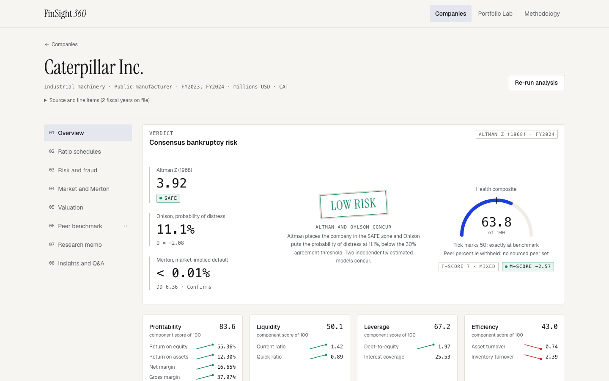
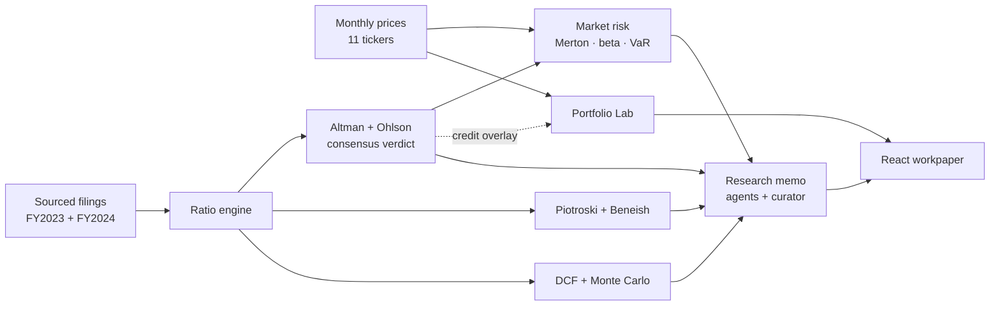
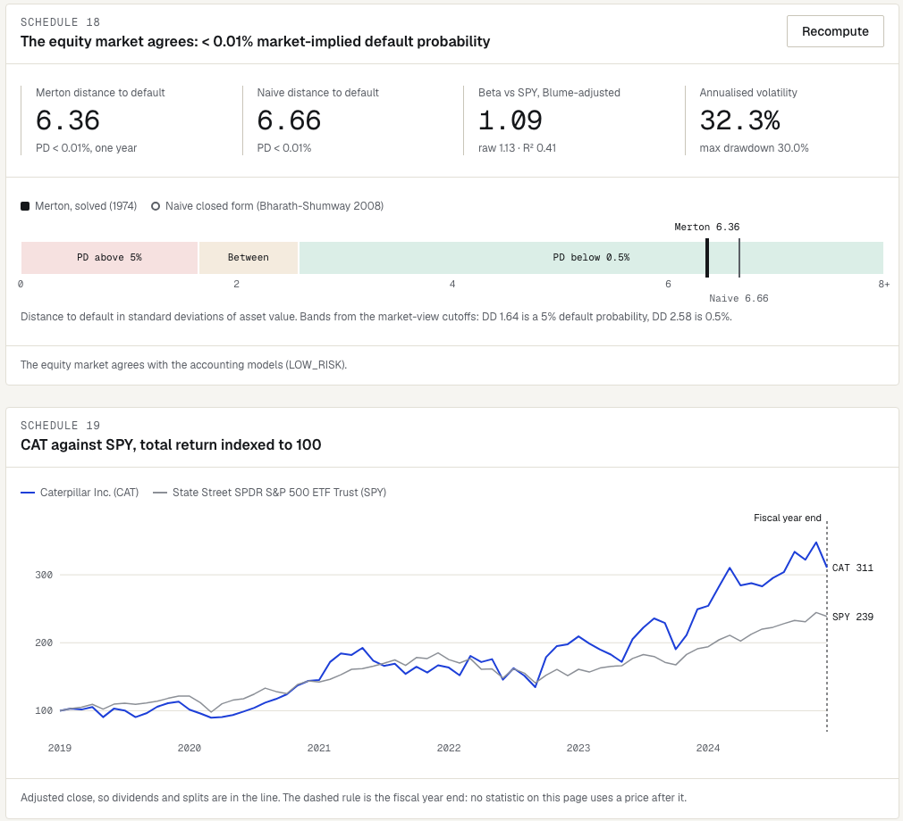
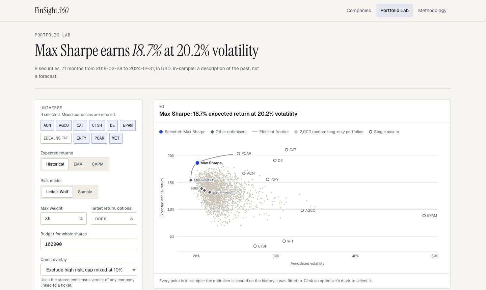
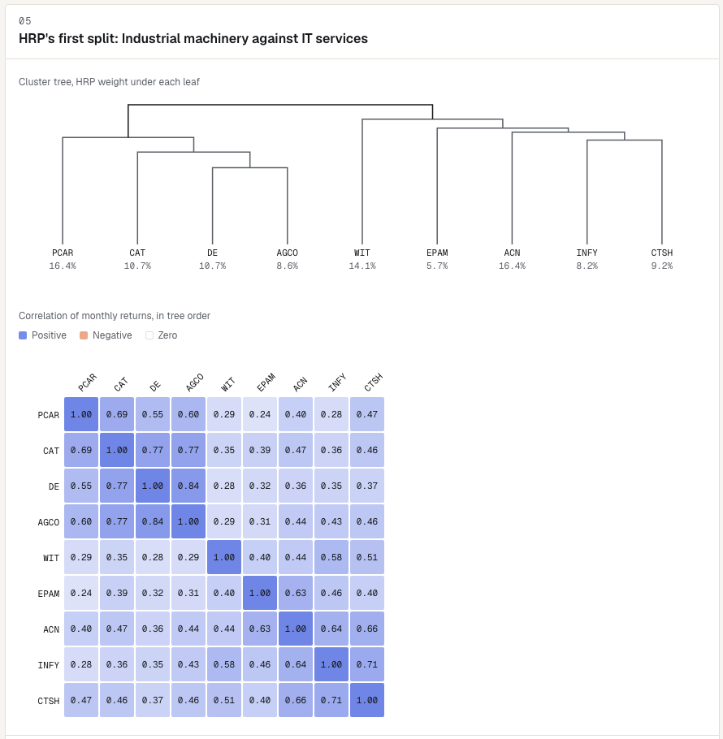
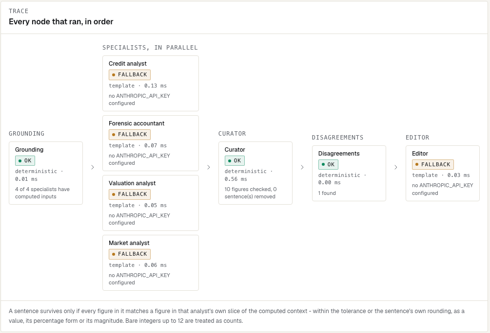
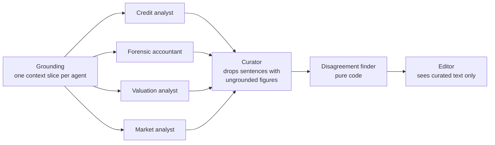
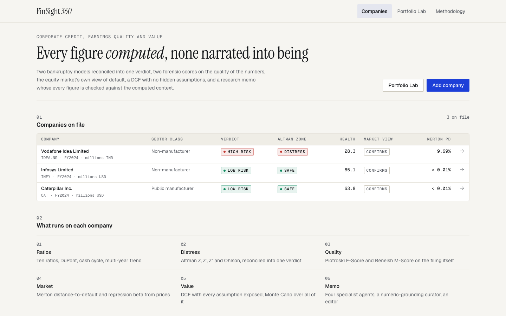
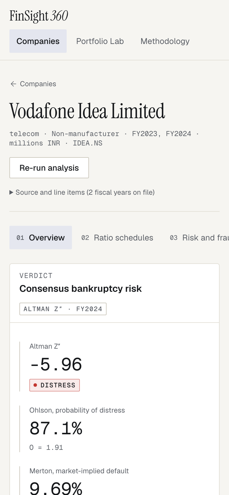

<div align="center">

# FinSight 360

**Corporate credit, earnings-quality and valuation analysis that computes every figure and lets the language model narrate none of them.**

[](https://github.com/IshaanS0112/FinSight-360/actions/workflows/ci.yml)


FastAPI · SQLAlchemy · PostgreSQL · NumPy · SciPy · React · TypeScript · Tailwind CSS · Docker



</div>

---

## Why this exists

Credit tools usually report one score and hide the arithmetic. FinSight 360 runs several independent models on the same sourced filing, shows every input and coefficient, and treats disagreement between models as a finding rather than noise. When Altman and Ohlson disagree the verdict is `MIXED_SIGNAL`, not an average.

The language model is kept on a short leash: it writes prose about numbers that already exist. Any figure it cites that is not in the computed context is removed before anyone sees it.

## What it does

| Area | What is computed |
|---|---|
| **Distress** | Altman Z, Z′ and Z″ (variant chosen by sector class), Ohlson O-Score, and a consensus verdict |
| **Earnings quality** | Piotroski F-Score (nine tests, each pass, fail or not evaluated) and Beneish M-Score |
| **Ratios** | Ten ratios, DuPont three- and five-step reconciled to ROE, cash conversion cycle, multi-year trend and CAGR |
| **Market risk** | Merton (1974) distance-to-default solved from the share price, Bharath–Shumway naive DD, regression beta, VaR, expected shortfall, drawdown |
| **Valuation** | DCF with FCFF, CAPM and WACC, every assumption an adjustable labelled input, plus seeded Monte Carlo |
| **Portfolio Lab** | Six optimisers on one set of estimates, efficient frontier, Hierarchical Risk Parity, component VaR, whole-share allocation, credit overlay |
| **Research memo** | Four specialist agents, a numeric-grounding curator, code-detected disagreements and an editor, with a full trace |

## How it fits together



Every box left of the memo is deterministic code in `backend/app/services/`, with no database or network access, so each claim about a number can be checked with `pytest` and nothing running.

---

## Screens

### Market view: does the equity market agree with the accounting models?



Asset value and asset volatility are solved from the two Merton equations. The result sits on a scale banded by the same probability cutoffs used to classify it, beside the naive closed form. Price statistics stop at the fiscal year end (the dashed line), so nothing looks ahead.

### Portfolio Lab: six methods, one set of estimates



Maximum Sharpe is the one highlighted mark; minimum volatility, target return, HRP, inverse volatility and equal weight sit in grey for comparison. Ledoit–Wolf shrinkage is applied to the covariance, and refusals (mixed currencies, short history, impossible caps) come back with a reason.



HRP's first split separates industrial machinery from IT services; reordering the correlation matrix by the tree makes the two blocks visible.

### Research memo: agents that cannot invent numbers





There is no web search. An agent that can fetch new numbers can also invent them, so every input is a figure already stored. Without an API key every node runs on a deterministic template and the trace says so, so the whole flow works offline.

<details>
<summary><b>More screens</b></summary>

<br>





</details>

---

## Sample results (FY2024, sourced filings)

| Company | Altman | Ohlson P(distress) | Consensus | Merton PD | Market view |
|---|---|---|---|---|---|
| Caterpillar | Z = 3.92 · SAFE | 11.1% | `LOW_RISK` | < 0.01% | CONFIRMS |
| Infosys | Z″ = 8.65 · SAFE | 0.5% | `LOW_RISK` | < 0.01% | CONFIRMS |
| Vodafone Idea | Z″ = −5.96 · DISTRESS | 87.1% | `HIGH_RISK` | 9.69% | CONFIRMS |

Two findings the tool surfaces on its own:

- **Caterpillar**: the applicable Z (1968) reads SAFE, but Z′ on the same balance sheet reads GREY at 2.00. The variant is a modelling choice, and the memo says so.
- **Vodafone Idea**: the solved Merton DD is 1.30 while the naive closed form gives 3.16. The naive model uses the trailing stock return as drift, and a 90% rally inflates it.

---

## Quick start

**Docker**

```bash
cp backend/.env.example .env      # optional: ANTHROPIC_API_KEY and ANTHROPIC_MODEL for model-written prose
docker compose up --build
```

Frontend at http://localhost:5173 · API docs at http://localhost:8000/docs

**Local**

```bash
cd backend && python3.12 -m venv .venv && source .venv/bin/activate
pip install -r requirements-dev.txt
DATABASE_URL="sqlite:////tmp/finsight.db" uvicorn app.main:app --port 8000

python backend/scripts/load_sample_filings.py --api http://localhost:8000   # sample data

cd frontend && npm install && npm run dev                                    # http://localhost:5173
```

If port 8000 is busy, run the API elsewhere and start the frontend with `FINSIGHT_API_URL=http://localhost:<port> npm run dev`.

---

## API

Interactive docs at `/docs`. Main groups:

| Group | Endpoints |
|---|---|
| Companies | `GET/POST /companies` · `GET /companies/summary` · `GET/DELETE /companies/{id}` |
| Analysis | `POST /companies/{id}/run-full-analysis` and each stage on its own |
| Valuation | `POST /companies/{id}/compute-valuation` · `POST /companies/{id}/run-scenario` |
| Market | `GET/POST /market/securities` · `PUT /companies/{id}/listing` · `POST /companies/{id}/compute-market-risk` |
| Portfolio | `POST /portfolio/optimize` · `GET /portfolio/runs/summary` · `GET /portfolio/runs/{id}` |
| Research | `POST/GET /companies/{id}/research-memo` · `POST /companies/{id}/insights/ask` |
| Reference | `GET /methodology` reports every coefficient and cutoff in force |

`409` means a prerequisite stage has not run. `422` means the input was refused, and the body says why.

---

## Validation

```bash
cd backend && pytest                 # 329 tests
cd frontend && npm run typecheck && npm run build
```

- Formulas are checked against independent NumPy computations on the sourced data, not against their own output.
- Known answers: the Merton solver satisfies both equations; two uncorrelated assets give inverse-variance weights; component VaR sums exactly to portfolio VaR.
- No look-ahead: market statistics are tested to stop at the fiscal year end (Infosys reports to March).
- Refusals are tested as refusals: mixed currencies, short histories, impossible weight caps, cross-currency beta.
- API tests run the real app against SQLite; CI also checks that the sample filings reproduce their documented verdicts.

## Project layout

```
backend/app/services/   computation: ratios, Altman, Ohlson, Merton, DCF, Monte Carlo,
                        market data, portfolio optimiser, research agents
backend/app/routers/    HTTP only        backend/tests/   329 tests
frontend/src/           pages, screens, hand-drawn SVG charts
data/                   sourced filings and prices, each with provenance notes
docs/                   architecture notes and schema
```

## Limits, stated plainly

- Monthly prices, so VaR and volatility are monthly figures, annualised for display.
- The Portfolio Lab is in-sample and survivorship-biased; weights describe the past, not a forecast.
- Merton's PD is a ranking signal: real defaults come earlier and with fatter tails than the model assumes.
- The shipped peer reference bands are illustrative; point `REFERENCE_BENCHMARKS_PATH` at your own.
- Banks and insurers get no Altman or Ohlson score. Merton still applies.
- Not investment advice.

## Acknowledgements

Portfolio methods follow [PyPortfolioOpt](https://github.com/PyPortfolioOpt/PyPortfolioOpt); market-risk and option-pricing ideas follow [QuantResearch](https://github.com/letianzj/QuantResearch); the multi-agent memo is adapted from [company-research-agent](https://github.com/guy-hartstein/company-research-agent). Methods from Altman (1968), Ohlson (1980), Piotroski (2000), Beneish (1999), Merton (1974), Bharath & Shumway (2008), Ledoit & Wolf (2004) and López de Prado (2016).

## Licence

MIT. See [LICENSE](LICENSE).
